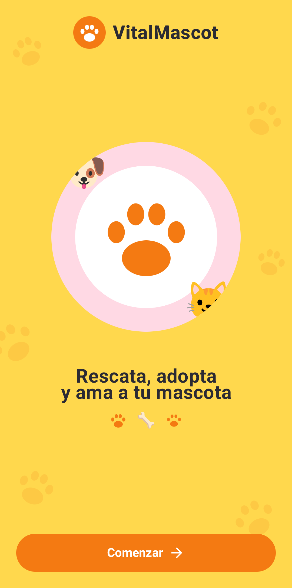

# 🐾 VitalMascot

<!--
  PORTADA PRINCIPAL
  Para cambiar la imagen, reemplaza el archivo docs/img/portada.png (o edita la ruta de abajo).
-->
<p align="center">
  
</p>

<p align="center"><em>Rescata, adopta y ama a tu mascota.</em></p>

---

## 📖 Información del proyecto

**VitalMascot** es una aplicación móvil Android para el **rescate, adopción y búsqueda de mascotas**, desarrollada para la asignatura **Desarrollo de Aplicaciones Móviles (DSY1105)** como proyecto de **Vinculación con el Medio (VcM)**. Está pensada para el contexto de **Chile**: distingue las mascotas **de compañía** de las **exóticas** (reptiles, aves, etc.), cuya tenencia tiene reglas propias.

### 🎯 Contexto VcM

Los refugios animales suelen difundir a sus rescatados por redes sociales, sin un catálogo ordenado. **VitalMascot** le da a un refugio (o a voluntarios) una herramienta simple para:

- Registrar animales rescatados (de compañía o exóticos) con foto, datos, teléfono y **lugar donde fueron encontrados**.
- Mostrarlos en un catálogo con búsqueda y filtros para posibles adoptantes.
- Recibir **solicitudes de adopción**, pidiendo la declaración de permiso cuando el animal es exótico.
- Reportar animales **perdidos** y marcar cuándo aparecen.
- Entregar información útil a la comunidad (veterinarios, playas pet‑friendly, refugios, eventos, tienda y consejos).

### 👥 Integrantes

| Nombre | Rol | GitHub |
| :--- | :--- | :--- |
| _Completar_ | _Completar_ | _@usuario_ |
| _Completar_ | _Completar_ | _@usuario_ |

### 📋 Gestión del proyecto

- **Tablero Trello:** _pegar aquí el enlace del tablero_
- **Repositorio:** _pegar aquí el enlace de GitHub_
- Flujo de trabajo: rama `main` estable + una rama por funcionalidad (`feature/...`), integradas mediante Pull Request.

---

## ✅ Requisitos funcionales

| ID | Requisito |
| :--- | :--- |
| RF-01 | La app muestra una pantalla de bienvenida y un onboarding que se puede omitir. |
| RF-02 | El usuario puede iniciar sesión con su cuenta de Google (Firebase Authentication) o continuar sin cuenta. |
| RF-03 | Con sesión activa, la app muestra el nombre y el correo del usuario en el saludo, el avatar con iniciales y el Perfil. Sin sesión muestra "Invitado" y ofrece iniciar sesión. El usuario puede cerrar sesión desde el Perfil. |
| RF-04 | El usuario puede registrar una mascota eligiendo su **tipo**: *de compañía* (especie Perro, Gato u Otro) o *exótica* (tipo Reptil, Ave, Mamífero pequeño, Anfibio u Otro exótico, más el nombre de la especie). Además indica nombre, edad (opcional), descripción, teléfono de contacto y foto (opcional, desde la galería). |
| RF-05 | La app guarda automáticamente la fecha y hora del sistema al registrar una mascota, una solicitud o un animal perdido. |
| RF-06 | Los formularios validan cada campo en tiempo real y muestran el error en rojo bajo el campo. El botón de guardar queda deshabilitado mientras el formulario no sea válido. |
| RF-07 | La app lista las mascotas guardadas, de la más reciente a la más antigua, indicando si son exóticas. |
| RF-08 | El usuario puede buscar mascotas por nombre o descripción y filtrarlas por especie (Todas, Perro, Gato, Otro, Exóticas). |
| RF-09 | El usuario puede abrir el detalle de una mascota y llamar al contacto con el marcador del teléfono. |
| RF-10 | El usuario puede eliminar una mascota, con diálogo de confirmación. También se borran su imagen y sus solicitudes de adopción. |
| RF-11 | Al registrar una **mascota exótica**, la app muestra un aviso sobre la normativa chilena y exige el N° de resolución SAG / permiso CITES / documento de origen, y una declaración de que el origen del animal es legal. |
| RF-12 | El usuario puede indicar **dónde fue encontrada** la mascota y, si se sabe, **dónde se extravió**: un texto descriptivo y la ubicación exacta, obtenida con el GPS del teléfono o eligiéndola en un mapa. |
| RF-13 | El detalle de la mascota muestra un **mapa** con un marcador donde fue encontrada y otro donde se extravió, y permite abrir cada punto en la app de mapas. |
| RF-14 | El usuario puede **solicitar la adopción** de una mascota con su nombre, teléfono, correo (precargado si inició sesión) y un mensaje. Si la mascota es exótica, debe declarar su propio permiso o documento y su cumplimiento de la normativa. |
| RF-15 | Quien publicó la mascota ve las solicitudes en el detalle y puede **aprobarlas o rechazarlas**. Cada solicitud tiene el estado PENDIENTE, APROBADA o RECHAZADA. |
| RF-16 | El usuario puede reportar un animal perdido con: nombre, especie, lugar donde fue visto por última vez, descripción, teléfono y foto (opcional). |
| RF-17 | La app lista los reportes de perdidos con filtro Todos, Perdidos o Encontrados. Permite marcar un reporte como "Encontrado" y llamar al contacto. |
| RF-18 | La app ofrece seis servicios con información de ejemplo: Veterinario, Playas, Refugios, Eventos, Tienda y Consejos, con tarjetas expandibles y botón de llamada cuando corresponde. Refugios enlaza con el listado de adopción. |
| RF-19 | El inicio muestra banners con contadores (mascotas esperando hogar y animales perdidos activos) y una cuadrícula de servicios. |
| RF-20 | El usuario acumula 10 puntos por cada mascota registrada. Se muestran en la barra superior y en el Perfil. |
| RF-21 | La navegación conecta todas las pantallas con transiciones animadas. Desde el Perfil se puede abrir el inicio de sesión. |

### Reglas de validación

Las reglas viven en `utils/Validators.kt`; los ViewModels las aplican y la UI solo muestra el resultado.

| Campo | Regla |
| :--- | :--- |
| Nombre | Obligatorio, 2 a 30 caracteres |
| Teléfono | Obligatorio, solo dígitos/espacios/`+`, 8 a 15 dígitos |
| Descripción | Obligatoria, 10 a 300 caracteres |
| Lugar (perdidos) | Obligatorio, 3 a 80 caracteres |
| Lugar (encontrada / extraviada) | Opcional; si se escribe, 3 a 80 caracteres |
| Edad | Opcional, máximo 20 caracteres |
| Especie exótica | Obligatoria en exóticas, 3 a 40 caracteres |
| N° de permiso o documento | Obligatorio en exóticas, 4 a 40 caracteres (letras, números, espacios y `- / .`) |
| Declaración de origen legal | Obligatoria en exóticas (casilla marcada) |
| Correo (solicitud) | Obligatorio, con formato de correo |
| Mensaje (solicitud) | Obligatorio, 10 a 300 caracteres |

- Los errores aparecen en tiempo real, solo en campos que el usuario ya tocó (`isError` + `supportingText` + ícono).
- El botón de guardar se deshabilita mientras `isValid == false`.
- Los campos de exótica solo se validan cuando la mascota es exótica.

## ⚙️ Requisitos no funcionales

| Categoría | Requisito |
| :--- | :--- |
| Arquitectura y mantenibilidad | MVVM con capas separadas (`data`, `ui`, `utils`, `auth`). Las validaciones están centralizadas y no dependen de la UI. |
| Persistencia | Room local con tres tablas (`pets`, `lost_pets` y `adoption_requests`), versión 3, con migraciones que conservan los datos. Los datos sobreviven al cierre de la app y se leen con `Flow`. |
| Rendimiento | Lecturas reactivas con `Flow`/`StateFlow`. El guardado y la copia de imágenes corren en corrutinas con `Dispatchers.IO`. Listas con `LazyColumn` y `LazyVerticalGrid`. |
| Usabilidad | Identidad visual coherente (mostaza, naranja, celeste y rosado), huellas de perro y gato como detalle, íconos en las acciones, errores claros y estados vacíos informativos. |
| Animaciones | Rebote de la mascota en la bienvenida, transiciones de pantalla (deslizar y fundido) y cambio animado entre pestañas del Home. |
| Seguridad y privacidad | No se guardan contraseñas: el acceso lo gestionan Google y Firebase. Las fotos se copian al almacenamiento interno privado. La galería se abre con el selector del sistema, sin permisos de almacenamiento. Permisos declarados: `INTERNET` y ubicación (`ACCESS_FINE/COARSE_LOCATION`), esta última solo se solicita cuando el usuario pulsa "Mi ubicación". |
| Cumplimiento normativo | La app informa sobre la normativa chilena de fauna exótica y exige declarar permisos, pero **no verifica documentos**: esa revisión corresponde al refugio. |
| Compatibilidad | Android 7.0 (API 24) o superior, con target API 37. |
| Disponibilidad | Todo funciona sin conexión, excepto el inicio de sesión con Google y los mapas. Sin clave de Google Maps, la app sigue funcionando y muestra las coordenadas. |
| Idioma | Interfaz íntegramente en español. |

## 🧭 Alcance

**Incluye**

- Registro de mascotas de compañía y exóticas, con búsqueda, filtros, detalle y eliminación, fotos y contacto telefónico.
- Declaración de origen legal (exóticas) y de permiso del adoptante, con aviso sobre la normativa chilena.
- Ubicación de dónde fue encontrada y dónde se extravió cada mascota, con GPS o mapa.
- Solicitudes de adopción con aprobación o rechazo por parte de quien publicó.
- Reporte y seguimiento de animales perdidos, con la marca de "encontrado".
- Directorio informativo de servicios para mascotas.
- Inicio de sesión opcional con Google y perfil básico.
- Persistencia local y validaciones por campo.

**No incluye (limitaciones actuales)**

- No hay servidor ni sincronización: los datos y las solicitudes viven solo en cada dispositivo, y la cuenta de Google no se vincula con ellos. Por eso la solicitud la ve quien usa ese mismo teléfono.
- La app **no verifica** permisos ni documentos (SAG, CITES, etc.): solo exige declararlos y los deja "pendientes de verificación".
- Los mapas interactivos requieren una clave de Google Maps; sin ella solo se muestran las coordenadas y el acceso a la app de mapas.
- La pestaña Mensajes es un marcador de posición, sin chat real. La Tienda es solo un catálogo, sin carrito ni pagos.
- Los servicios son datos de ejemplo fijos, sin API.
- No se pueden editar las mascotas ya registradas, solo crearlas o eliminarlas.
- Los reportes de animales perdidos guardan el lugar como texto; todavía no tienen mapa.
- Los puntos son un contador sin canje. No hay notificaciones.
- Solo Android y solo en español.

## ⚖️ Marco legal de referencia (Chile)

> Esta sección es informativa y **no constituye asesoría legal**. La normativa puede cambiar: confirma siempre con el SAG.

- **Animales de compañía:** la [Ley 21.020 (Ley Cholito)](https://www.bcn.cl/leychile/navegar?i=1106037) regula la tenencia responsable de mascotas y animales de compañía, con reglas de identificación y registro (algunas específicas de perros y gatos).
- **Fauna silvestre y exótica:** se rige por la Ley de Caza (4.601, modificada por la 19.473) y su reglamento, y por la convención CITES. La autoridad es el SAG.
- **Internación de fauna exótica:** requiere permiso de importación del SAG, certificado zoosanitario y, si la especie está protegida, permiso CITES. Ver [SAG: ingreso de aves de compañía](https://www.sag.gob.cl/ambitos-de-accion/ingreso-de-aves-de-compania) y [ChileAtiende](https://www.chileatiende.gob.cl/fichas/58183).
- **Compra y procedencia:** el SAG recomienda adquirir mascotas exóticas en establecimientos inscritos en el registro nacional de tenedores de fauna silvestre y conservar los documentos que acrediten su procedencia legal. Ver [SAG: adquirir mascotas exóticas de manera legal](https://www.sag.gob.cl/noticias/sag-informa-sobre-la-importancia-de-adquirir-mascotas-exoticas-de-manera-legal).
- **Lo que la app hace:** pide el N° de resolución/permiso/documento y una declaración de origen legal, y lo muestra como "pendiente de verificación" para que el refugio lo revise.

## 📝 Historias de usuario

**HU-01: Registrar una mascota en adopción**
*Como voluntario de un refugio, quiero registrar una mascota con su foto y datos de contacto para que otras personas puedan conocerla y adoptarla.*

- Si el nombre, el teléfono o la descripción no cumplen las reglas, aparece el error en rojo bajo el campo y "Guardar y publicar" queda deshabilitado.
- Si el formulario es válido, el botón se habilita y la mascota se guarda con la fecha y hora actuales.
- Si elijo una foto de la galería, se muestra en la tarjeta de la mascota.
- Tras guardar, la mascota aparece al inicio de la lista y mi contador de puntos sube en 10.

**HU-02: Buscar una mascota y contactar a quien la cuida**
*Como persona que quiere adoptar, quiero buscar y filtrar mascotas para encontrar una que me interese y llamar a quien la cuida.*

- Al escribir en el buscador, la lista se filtra al instante por nombre o descripción.
- Al elegir Perro, Gato, Otro o Exóticas, solo veo mascotas de ese grupo, y "Todas" quita el filtro.
- Al abrir una mascota veo su detalle completo y un botón de llamada que abre el marcador con su número.
- Si nada coincide, la app muestra un mensaje de lista vacía en lugar de una pantalla en blanco.

**HU-03: Reportar un animal perdido y marcarlo como encontrado**
*Como vecino de la comunidad, quiero reportar un animal perdido con el lugar donde fue visto y marcarlo como encontrado cuando aparezca, para ayudar a reunirlo con su familia.*

- Al reportar, debo indicar nombre, especie, lugar donde fue visto (3 a 80 caracteres), descripción y teléfono. El reporte queda con fecha y hora del sistema y la etiqueta roja "PERDIDO".
- En el listado puedo filtrar por Todos, Perdidos o Encontrados.
- Al pulsar "marcar como encontrado", la etiqueta cambia a verde "ENCONTRADO" y el reporte sale de los perdidos activos. El contador del Home se actualiza.
- Puedo llamar al contacto del reporte desde la tarjeta.

**HU-04: Registrar y adoptar una mascota exótica de forma responsable**
*Como refugio y como adoptante, quiero que las mascotas exóticas se registren y se adopten dejando constancia de su origen y permisos, para cumplir con la normativa chilena.*

- Al elegir "Exótica" al registrar, aparecen el tipo de animal, el nombre de la especie, un aviso sobre la normativa (con enlace al SAG), el campo de N° de permiso/documento y la casilla de declaración. El botón de guardar sigue deshabilitado hasta completarlos.
- En el detalle de la mascota veo que es exótica, el documento declarado y la advertencia de que está pendiente de verificación.
- Al solicitar su adopción, el formulario me pide mi propio permiso o documento y que declare mi cumplimiento de la normativa.
- La solicitud queda PENDIENTE; quien publicó la puede aprobar o rechazar.

**HU-05: Indicar dónde fue encontrada una mascota**
*Como rescatista, quiero registrar dónde encontré a la mascota y, si lo sé, dónde se extravió, para ayudar a que su familia la reconozca.*

- Puedo escribir el lugar y guardar la ubicación exacta con el botón "Mi ubicación" (la app pide el permiso en ese momento) o eligiéndola en el mapa.
- Puedo quitar una ubicación guardada si me equivoqué.
- En el detalle de la mascota veo un mapa con un marcador donde fue encontrada y otro donde se extravió, y puedo abrirlos en la app de mapas.
- Si no hay clave de Google Maps, veo las coordenadas y el botón "Abrir en Maps".

---

## 🏗️ Estructura del proyecto

Paquete raíz `com.vcm.adoptamascota` (se mantiene para no perder la instalación existente; el nombre visible de la app es **VitalMascot**).

```
com.vcm.adoptamascota
├── auth               AuthRepository (Firebase + Google), LoginScreen, SignOutButton
├── data
│   ├── local          PetEntity, LostPetEntity, AdoptionRequestEntity, DAO y AppDatabase (Room)
│   ├── repository     PetRepository, LostPetRepository, AdoptionRepository
│   └── ServicesData   Contenido estático de los servicios
├── ui
│   ├── state          PetListState, PetFormState, LostFormState, AdoptionFormState (estados inmutables)
│   ├── viewmodel      PetViewModel, LostPetViewModel, AdoptionViewModel (lógica + StateFlow)
│   ├── screens        Pantallas Compose (View), incl. AdoptionRequestScreen y LocationPickerScreen
│   ├── components     PetImage, PetTextField, PetMap (mapa de ubicación), PawDecor (huellas)
│   ├── navigation     AppNavigation (NavHost)
│   └── theme          Paleta de colores y tema Material 3 (VitalMascotTheme)
└── utils              DateUtils, ImageStorage, Validators, LocationUtils (GPS y mapas)
```

**Responsabilidades (MVVM)**

- **Model:** `PetEntity`, `LostPetEntity` y `AdoptionRequestEntity` (tablas de Room).
- **View:** los `@Composable` solo dibujan el estado y notifican eventos; no contienen reglas de negocio.
- **ViewModel:** expone `StateFlow`, aplica filtros (`combine` de Room + búsqueda + especie) y valida formularios.
- **Repository:** capa intermedia entre el ViewModel y el DAO. `AuthRepository` hace lo mismo con Firebase Authentication.

**Flujo de datos:** `Pantalla → evento → ViewModel → Repository → DAO/Room` y de vuelta `Room → Flow → ViewModel → StateFlow → Pantalla`.

### 📱 Pantallas y navegación

| Pantalla | Descripción |
| :--- | :--- |
| **Welcome** | Bienvenida con fondo mostaza y huellas, logo VitalMascot, mascota animada y botón "Comenzar". |
| **Login** | Inicio de sesión con Google, o "Continuar sin cuenta". Si ya hay sesión, avanza sola. |
| **Onboarding** | 3 páginas deslizables con fondo degradado y huellas, botón OMITIR y puntos de paginación. |
| **Home** | Barra con iniciales y puntos, banners *Adoptar* y *Animales Perdidos*, grilla de 6 servicios y barra inferior (Inicio, Buscar, Mensajes, Perfil). |
| **Perfil** | Nombre y correo de la cuenta (o "Invitado"), estadísticas e inicio/cierre de sesión. |
| **Adopción** | Catálogo desde Room con búsqueda por texto y `FilterChip` por especie (incluye Exóticas). |
| **Registrar mascota** | Formulario validado con tipo de mascota, datos legales de exóticas, ubicación y foto de la galería. |
| **Selector de ubicación** | Mapa para colocar el marcador de dónde fue encontrada o extraviada, o usar la ubicación actual. |
| **Detalle** | Datos completos, mapa de ubicación, datos de exótica, llamada al contacto, solicitudes y eliminación con confirmación. |
| **Solicitar adopción** | Formulario del adoptante; pide permiso/documento y declaración si la mascota es exótica. |
| **Animales Perdidos** | Listado con filtro Todos/Perdidos/Encontrados, y formulario de reporte validado. |
| **Servicios** | Veterinario, Playas, Refugios, Eventos, Tienda y Consejos (tarjetas expandibles, datos de ejemplo). |

Flujo de navegación: `Welcome → Login → Onboarding → Home → (Adopción → Registrar → Selector de ubicación | Detalle → Solicitar adopción) · (Perdidos → Reportar) · (Servicio) · (Perfil → Login)`

### 💾 Persistencia con Room

Base de datos `pet_adoption_db` (SQLite), versión 3.

| Tabla | Entidad | Contenido |
| :--- | :--- | :--- |
| `pets` | `PetEntity` | Mascotas en adopción: datos, categoría (compañía/exótica), especie exótica, permiso declarado, ubicación donde fue encontrada y donde se extravió, foto y fecha. |
| `lost_pets` | `LostPetEntity` | Reportes de animales perdidos: datos, lugar, foto, fecha, estado `isFound`. |
| `adoption_requests` | `AdoptionRequestEntity` | Solicitudes de adopción: mascota, datos del adoptante, mensaje, permiso declarado y estado. |

- Los DAO devuelven `Flow`, por lo que la UI se actualiza sola cuando cambia la tabla.
- `Migration(1, 2)` agrega `lost_pets` y `Migration(2, 3)` agrega los campos de exótica y ubicación (las mascotas existentes pasan a "de compañía") y la tabla de solicitudes, sin borrar datos.
- Las fotos se copian al almacenamiento interno de la app (`ImageStorage`) porque el `Uri` de la galería es temporal.

### 📲 Recursos nativos

1. **Galería:** `rememberLauncherForActivityResult(ActivityResultContracts.GetContent())` para elegir la foto de la mascota.
2. **Fecha/hora del sistema:** `DateUtils` usa `java.util.Date` y `SimpleDateFormat` para registrar el momento exacto de cada guardado.
3. **Marcador telefónico:** `Intent.ACTION_DIAL` para llamar al contacto desde detalle, perdidos y servicios.
4. **Selector de cuentas de Google:** Credential Manager muestra las cuentas del dispositivo para iniciar sesión.
5. **Ubicación (GPS):** `FusedLocationProviderClient` obtiene la posición actual, con permiso en tiempo de ejecución.
6. **App de mapas:** `Intent.ACTION_VIEW` con `geo:` abre las coordenadas en la app de mapas del teléfono.

### ✨ Animaciones y detalles visuales

- Transiciones de navegación (deslizamiento + fundido) en el `NavHost`.
- Rebote infinito de la mascota en Welcome y puntos de paginación animados en Onboarding.
- `animateItem()` al filtrar/reordenar listas y `Crossfade` entre estados cargando / vacío / lista.
- Tarjetas expandibles con `animateContentSize()` y cambio de pestañas con `AnimatedContent`.
- Huellas de perro y de gato dibujadas con `Canvas` (`PawPrint` y `PawScatter`) como fondo decorativo y marca de agua en los banners.
- Ícono de la app con huella naranja sobre fondo amarillo.
- **Botones intuitivos:**
  - Lápiz ✏️ en los botones de agregar (*Registrar* mascota y *Reportar* animal perdido).
  - Botón *Volver* con flecha y garrita de perro (`PawBackButton`) en todas las barras superiores.
  - Garrita en la pestaña *Inicio*, en las tarjetas de mascotas (indica que se pueden abrir) y en el botón *Ver mascotas*.
  - Corazón en *Solicitar adopción*, teléfono en *Llamar*, lupa en *Ver reportes* y ubicación en *Mi ubicación*.

---

## 🛠️ Herramientas y tecnologías

| Área | Herramienta | Versión |
| :--- | :--- | :--- |
| Lenguaje | **Kotlin** | 2.2.10 |
| Interfaz | **Jetpack Compose** + **Material 3** (BOM) | 2026.02.01 |
| Navegación | **Navigation Compose** | 2.9.0 |
| Ciclo de vida | Lifecycle (ViewModel y runtime Compose) | 2.9.4 |
| Persistencia | **Room** (+ **KSP** para el compilador) | 2.7.2 (KSP 2.2.10-2.0.2) |
| Asincronía | **Coroutines** y **Flow** | — |
| Imágenes | **Coil** | 2.7.0 |
| Autenticación | **Firebase Authentication** (BoM) | 34.4.0 |
| Acceso con Google | **Credential Manager** + Google ID | 1.5.0 / 1.1.1 |
| Servicios de Google | Plugin **Google Services** (lee `google-services.json`) | 4.5.0 |
| Integración Firebase | `kotlinx-coroutines-play-services` (`await()` sobre tareas) | 1.10.2 |
| Mapas | **Google Maps SDK for Android** + **Maps Compose** | 20.1.0 / 7.0.0 |
| Ubicación | **Play Services Location** (`FusedLocationProviderClient`) | 21.4.0 |
| Compilación | **Gradle** (Kotlin DSL) y Android Gradle Plugin | AGP 9.4.1 |
| IDE | **Android Studio** | — |
| Pruebas | JUnit (pruebas de `Validators`), Espresso y Compose UI Test | — |
| Colaboración | **Git / GitHub** y **Trello** | — |

Configuración del SDK: `minSdk 24` · `targetSdk 37` · `compileSdk 37` · Java 11.

> **Nota sobre versiones:** varias librerías recientes se compilan con Kotlin 2.4 y no se pueden leer con el Kotlin 2.2.10 del proyecto. Por eso se usa el BoM de Firebase `34.4.0` (el `35.x` requiere Kotlin 2.4) y Maps Compose `7.0.0` (las `8.4+` y `9.x` requieren Kotlin 2.4).

---

## ▶️ Cómo ejecutar

```bash
git clone <url-del-repositorio>
```

1. Abrir la carpeta en **Android Studio** y esperar la sincronización de Gradle.
2. Colocar el archivo `google-services.json` de Firebase en `app/` (ver la sección siguiente).
3. _(Opcional)_ Configurar la clave de Google Maps (ver más abajo) para ver los mapas dentro de la app.
4. Elegir un emulador **con Google Play** o un dispositivo (Android 7.0+).
5. Presionar **Run ▶**.

### 🔥 Configuración de Firebase (inicio de sesión con Google)

1. En la [consola de Firebase](https://console.firebase.google.com) abrir el proyecto y entrar a **Authentication → Sign-in method → Google → Habilitar**.
2. En **Configuración del proyecto → tu app Android** (`com.vcm.adoptamascota`), agregar las huellas **SHA-1** y **SHA-256** de cada equipo de desarrollo. Se obtienen con:
   ```bash
   ./gradlew signingReport
   ```
3. Descargar el `google-services.json` actualizado y guardarlo en `app/google-services.json`. Debe incluir un cliente OAuth `client_type: 3`; si `oauth_client` viene vacío, el inicio de sesión falla.
4. Cada integrante que compile con su propia llave debug debe registrar también su SHA-1/SHA-256.

### 🗺️ Configuración de Google Maps (opcional)

Sin clave, la app funciona igual pero muestra coordenadas en lugar del mapa y oculta el botón "Elegir en mapa".

1. En [Google Cloud Console](https://console.cloud.google.com), usar el proyecto de Firebase (o crear uno) y **habilitar "Maps SDK for Android"**. Google puede exigir una cuenta de facturación vinculada al proyecto; revisa las condiciones vigentes en la consola.
2. Crear una **clave de API** y restringirla a aplicaciones Android: paquete `com.vcm.adoptamascota` y el SHA-1 de tu equipo.
3. Agregar la clave en `local.properties` (archivo local que no se sube al repositorio):
   ```properties
   MAPS_API_KEY=tu_clave_aqui
   ```
4. Sincronizar y volver a ejecutar.

---

## 🗂️ Cobertura de la rúbrica

| Criterio | Dónde se evidencia |
| :--- | :--- |
| IE 2.1.1 Interfaz y navegación | Paleta coherente, pantallas con huellas decorativas, `AppNavigation.kt` |
| IE 2.1.2 Formularios y validaciones | `AddPetScreen`, `AddLostPetScreen`, `AdoptionRequestScreen`, `PetTextField` |
| IE 2.2.1 Lógica desacoplada | `Validators`, `PetViewModel`, `LostPetViewModel`, `AdoptionViewModel`, estados en `ui/state` |
| IE 2.2.2 Animaciones | Sección *Animaciones y detalles visuales* |
| IE 2.3.1 Modularidad y persistencia | Paquetes `auth` / `data` / `ui` / `utils`, Room con migraciones (v1→v3) |
| IE 2.3.2 Control de versiones | Historial de commits, ramas y tablero Trello |

> **Nota:** los servicios del Home (veterinarios, playas, eventos, tienda, consejos) usan datos de ejemplo y teléfonos ficticios.
